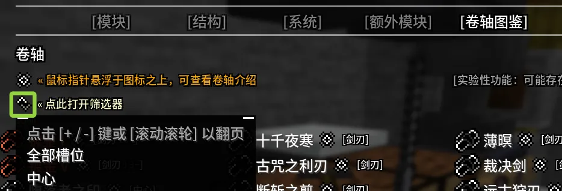
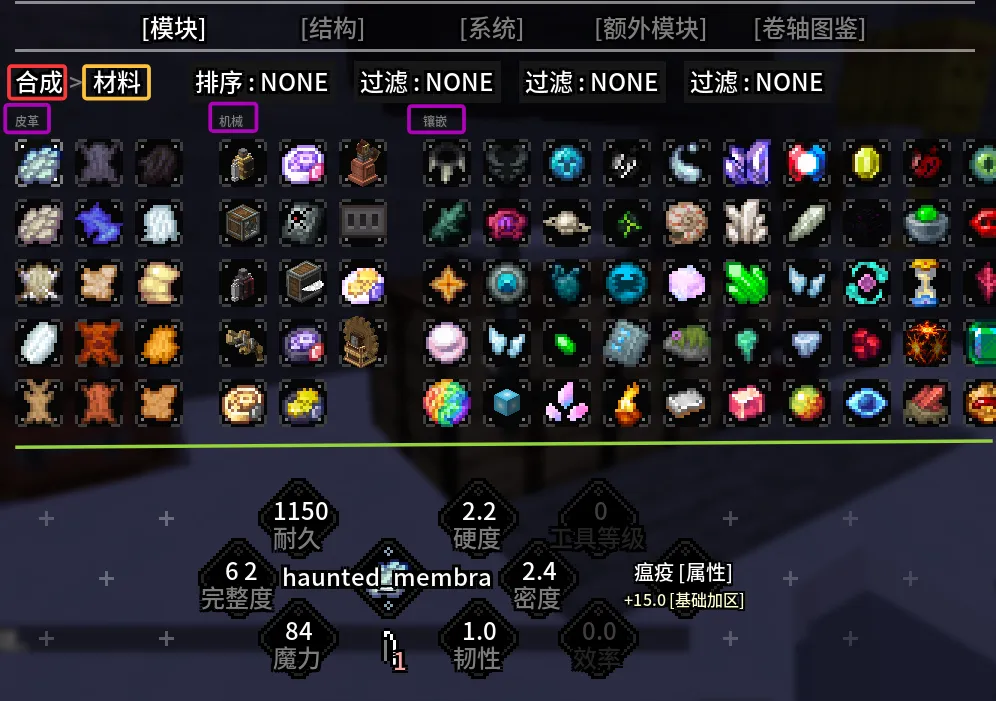
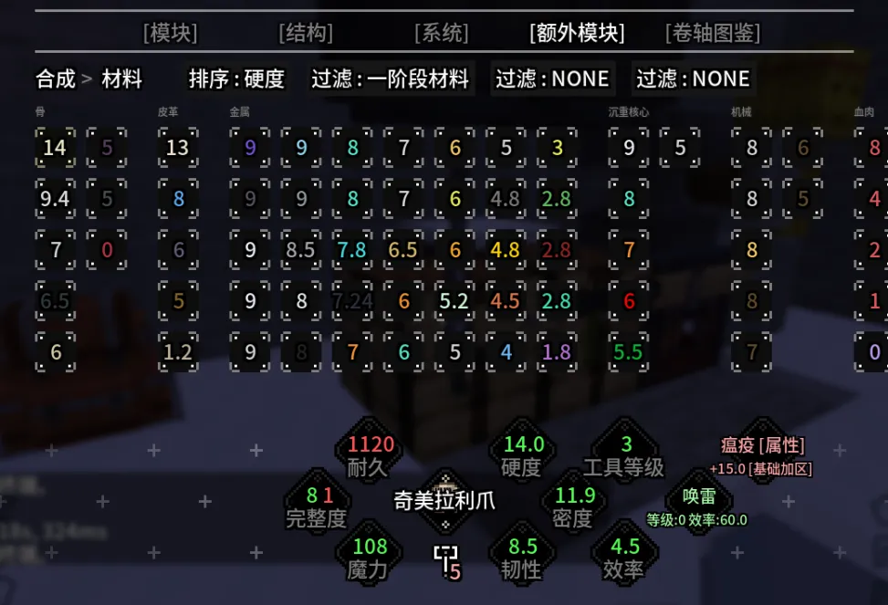
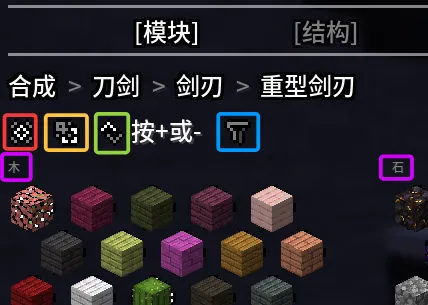
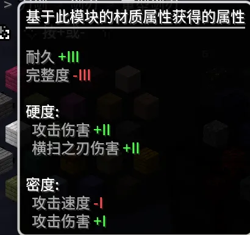
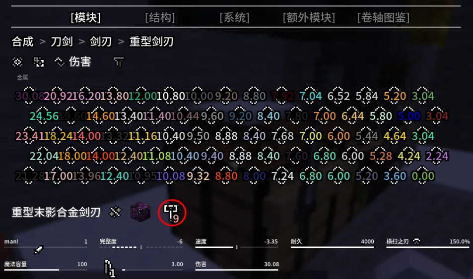
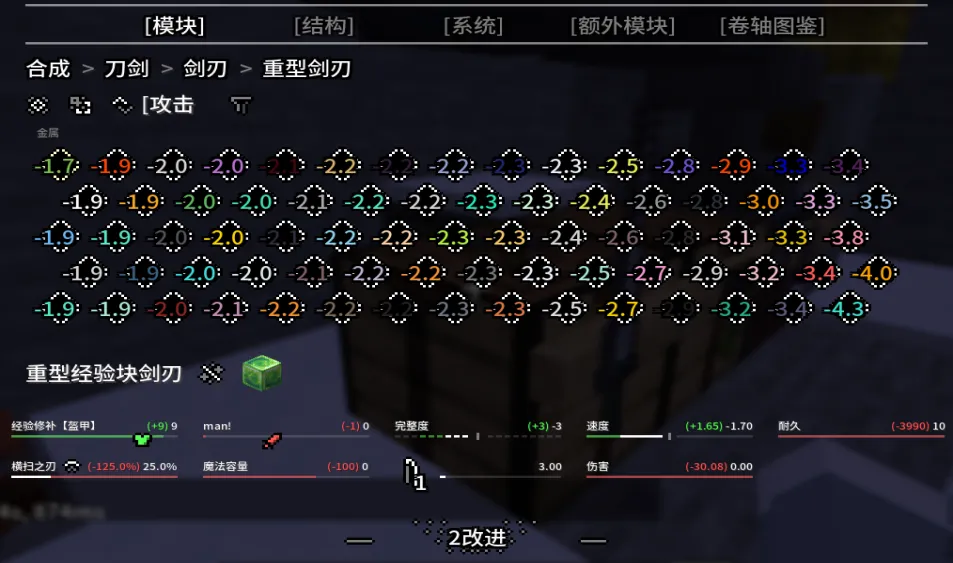
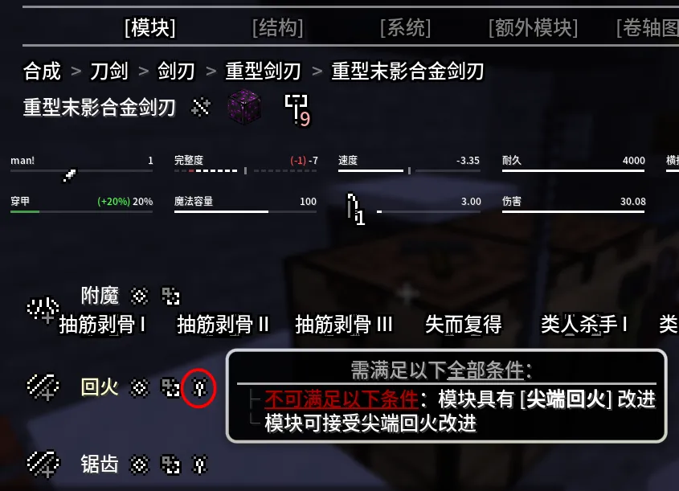
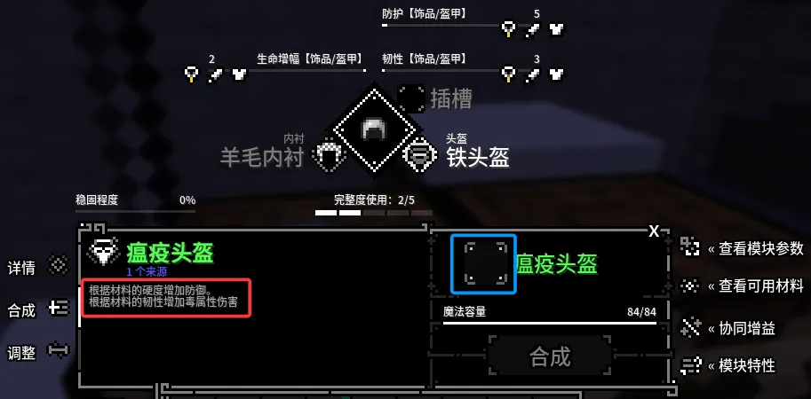

全息球作为tetra的材料大全，同时也是**锻造模拟器**，可根据不同材料的不同数据进行排列，方便玩家进行各种材料的排行，从而择优锻造。{.read-more}

## 全息球GUI

在原版tetra中，你需要手持全息球右键来打开GUI，来查看材料的属性或进行部件的模拟锻造。而本包进行了魔改，无需携带全息球，随时随地都可以按<kbd>H</kbd>(默认按键)来打开全息球的GUI。

当前版本已经对全息球GUI进行了汉化，在GUI的上方共有`[模块]`、`[结构]`、`[系统]`、`[额外模块]`、以及新添加的`[卷轴图鉴]`这五个部分。其中`[结构]`与`[系统]`两个部分暂无内容，因此仅介绍剩余三个部分。

### [模块]

该部分共有**弓**、**工具腰带**、**单头工具**、**刀剑**、**双头工具**、**双头工具**、**弩**、**盾牌**以及**材料**9个板块。

### [额外模块]

该部分分为三页，每一页都有==材料==板块，且功能与[模块]部分的“材料”板块完全相同，因此不再重复提及。

::: table full-width

|第一页|第二页|第三页|
|:---:|:---:|:---:|
|刀剑 鞋子 护腿 蒸汽引擎 头盔 胸甲 扳手 单头工具 锻造饰品|荣耀之证 毒素瓶 手套 灾变之心 戒指 项链 原初温床 足力健 护心镜|皇冠 锻造锤|

:::

### [卷轴图鉴]

该部分共展示当前版本的七十四种卷轴，可通过筛选器对可用部位进行筛选。

## 全息球模拟锻造

### 材料板块

打开全息球GUI，点击`[模块]`或`[额外模块]`的==材料板块==，并点击任意材料，将会显示以下页面（以第一个材料为例）：

GUI上方将显示`排序`按钮与三级`过滤`按钮(过滤不分先后)。此外，橙色框为当前页面，红色框为上一级页面，紫色框为材料类型。同时，当前页面被绿色横线区分为上下两个区域，当鼠标在其中一个区域内滑动滚轮时，该区域页面将进行左右滑动。

当玩家需要对材料进行某个属性的排序时，可通过`排序`按钮选择属性，此时各材料将显示为该项属性的具体数值，并按照数值==高低从左至右==排列。同时，还可通过`过滤`按钮对材料进一步筛选。

---

例如，玩家A想查看**一阶段材料**中**硬度最高**的一个，那么A需在`排序`中选择==硬度==，在任意`过滤`中选择==一阶段材料==即可，此时将鼠标移至任意材料，即可显示该材料信息：

此时，GUI下方显示的材料信息出现了两种颜色，红色表示：对于该属性，当前材料比之前选中的材料降低了数值；绿色则表示该属性数值提高。

### 其他板块

以[模块]部分的**刀剑**板块为例：玩家A希望锻造一柄重型剑刃，于是打开全息球GUI并点击[模块]的**刀剑**板块，此时GUI显示**附层**、**护手**、**剑柄圆头**、**剑刃**、**剑柄**五个部件，同时左上角出现==合成>刀剑=={.tip}字样。

A点击`剑刃`部件，左上角显示为==合成>刀剑>剑刃=={.tip}，以及两个`/`按钮，同时展示所有==未隐藏的==剑刃类型共8个。之后，A点击`重型剑刃`，GUI显示以下页面：

其中红色框为该部件的简要介绍，黄色框为该部件根据材料对应数值所能提供的属性，绿色框为排序按钮，蓝色框为材料名称搜索，紫色框为材料类型。

此时玩家A移动鼠标悬浮至红色框内，显示如下：

>重型剑刃牺牲了攻击速度以增加伤害，总能在完全蓄力时发动横扫。

接着又移动鼠标悬浮至黄色框内，显示如下：

结合以上所展示的信息，A得知：`重型剑刃`是基于材料==硬度（主要）=={.important}和 ==密度（次要）== 来获得攻击伤害，同时基于硬度增加横扫之刃伤害，基于密度降低攻击速度。因此A认为应该选择==高硬度材料作为剑刃=={.info}，于是便点击了绿色框进行排序,同时利用英文输入法状态下的<kbd>-</kbd>、<kbd>+</kbd>进行翻页，但并未找到**硬度**字样，只能选择**伤害**字样，此时各材料图标变成了数字，并按照数值高低从左至右排列 ==可按住<kbd>Shift</kbd>重新显示材料图标=={.tip} ，A利用鼠标滚轮，查看右边的材料，发现**金属**类型排列第一的材料数值最高，遂点击该材料，于是GUI下方显示该材料的信息：

A将鼠标移到红圈内，得知利用该材料制作`重型剑刃`部件需要使用==9级锤子=={.danger}，接着A又将鼠标移到红圈**左边**的材料图标上，得知该材料为**末影合金块**，是==阶段三=={.tip}的金属材料，此时A不小心按住了<kbd>Ctrl</kbd>键，发现了更多关于该材料的信息。

看完信息之后A又注意到，该材料会降低3.35的**速度**，因此A再次点击排列按钮，并选择了`攻击速度`，此时GUI显示材料数值按照增加攻击速度的多少从左至右排列，且GUI下方依旧留着==重型末影合金剑刃==的信息，接着A又将鼠标移至新排列第一的金属材料上：

可以看到，这个叫做==经验块=={.important}材料被与 ==末影合金块== 进行了对比，且词条的绿色部分为新增加的效果，红色部分为新减少的效果，显而易见的，**简直太差劲了！**于是乎，A又将鼠标移至其他材料进行对比，最终决定还是先用“末影合金块”作为剑刃材料。但同时，A又注意到，“重型末影合金剑刃”各词条最下方的==3改进=={.important}字样。因此A点击了该字样：

A将鼠标移至各个按钮，得知了这些**改进**的信息，当A将鼠标移动至红圈内时，发现上方的词条中`完整度`由`-6`变成了`-7`，但多出了一个数值为20%的 ==穿甲== ，于是A按下红圈内的按钮，将鼠标移动至 ==穿甲== 词条，发现该词条能提供==无视目标20%护甲值=={.important}的效果。

当A查看完剩下的按钮之后，对剑刃材料的选择便有了想法，于是就想去查看其他部件，因此将鼠标移动至上方的`刀剑`并点击，回到了`刀剑`这一级的GUI，而此时`合成`的左边也出现一个<kbd>Q</kbd>的图标，显然，按<kbd>Q</kbd>也能返回上一级页面。

## 配合锻造加工台

以瘟疫头盔为例{.read-more}

由红色框中的信息可知

1. 该部件由材料的==硬度=={.tip}来提供==防御==
2. 由材料的==韧性=={.tip}来增加==毒属性伤害==

而当你将任意材料置于蓝色框内时

- 上方将显示新旧材料提供的具体属性对比
- 将鼠标置于右边的**查看可用材料**按钮图标，可显示该部件能使用的材料类型，当你点击该按钮图标，将会跳转至全息球页面。

此时，你可选中任意材料以查看该材料作为**瘟疫头盔**时所提供的各种属性，基本上是 ==防护[饰品/盔甲]== 、 ==瘟疫[饰品/盔甲]== 以及 ==完整度== 。

通过点击`筛选`按钮，我们可以看到 **[盔甲＆饰品]护甲值** 等词条，但却并没有**瘟疫[饰品/盔甲]**词条。
::: note
**瘟疫伤害**、**火焰伤害**词条均为==主手生效=={.warning}，==盔甲不生效=={.danger}。
:::
所以，我们只能通过对==比材料的韧性==，来判断各个材料所提供的**瘟疫[饰品/盔甲]**词条数值高低。

基于此，你可以点击`[额外模块]`部分，再点击`材料`板块，点击筛选按钮，选择`韧性`，并选择你希望的过滤条件，比如==1阶段材料==，再按照==瘟疫头盔==的可用材料类型，来选择合适的材料。对比完材料的数值后，再点击[模块]部分，继续查看==瘟疫头盔==的内容。

经过初步了解，相信你已经对Tetra全息球有了全新的了解！然而，实践是检验真理的唯一标准，快到你的世界里尝试一番吧！
