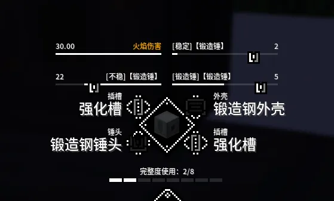
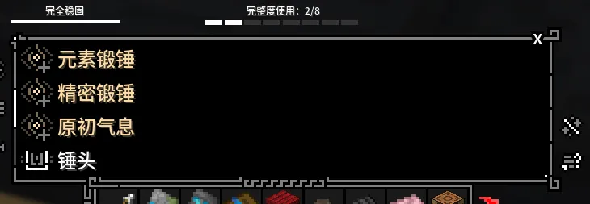
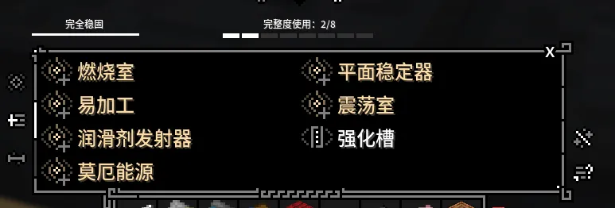

本包自1.1版本开始加入了锻造锤模块化改造玩法以取代原本的锻造师等级玩法且锻造锤**不再需要放置热电池提供动力**，一切对锻造锤的改造都将在加工台进行。{.read-more}
>[!important]
>锻造锤未经改造无法使用！

## 锻造锤词条

模块化锻造锤拥有 **[不稳]** **[稳定]** **[锻造锤]**三个词条。

1. **[不稳]**：锻造锤在改造时每级故障率提升1%。
2. **[稳定]**锻造锤在改造时每级故障率降低1%。
::: note
锻造锤初始拥有30%的故障概率，故障后锤头会掉落下来无法复位，需要4级及以上锤头右击锤头方块复位
:::
3. **[锻造锤]**：锻造锤生效时提每级供1锤头等级。

---

如图所示模块化锻造锤，该锻造锤有**5锤头等级**和**30+22-2=50%**故障率
::: note
该处的**30**为上述**初始30%故障率**，==并非图中展示的火焰伤害数值=={.danger}。
:::

## 锻造锤模块

锻造锤改造模块包括**外壳**、**锤头**、**强化槽**。

### 外壳

提供 **[不稳]** 和==总完整度==。依据材料硬度调整 **[不稳]** 等级，==硬度== 越 ==低=={.danger} **[不稳]** 等级越高。

### 锤头

提供 **[稳定]**并提供5级基础锤等级，依据材料韧性调整 **[稳定]** 等级，==韧性==越 ==高=={.tip} **[稳定]** 等级越高。

### 强化槽

每个锻造锤有**两个强化槽**，本体固定材料为==锻造钢锭==，提供各种强化选项。

## 锻造锤强化

### 锤头强化

- **元素锻锤**：第一个栏位放`锻造模板(魔麟)`,根据第二个材料来获取加成。

  - |风|火|毒|雷|
    |:--:|:--:|:--:|:--:|
    |漂浮核心|必火恶怪粘胶|裂变核心|闪电蠕虫甲壳|

::: note
每个锻造锤只能同时容纳一种元素锻锤的强化。
:::

- **精密锻锤**：改造部件时保留原词条属性，==使用16个`高级处理器`==。

- **原初气息**：改造时，消耗玩家消耗==400点营养值==，让`活体剑刃`沾染==原初气息==，活体剑刃生命转伤害的倍率增加40%。
  - 使用16个原初核心、1个蕾莓、3个下界之星。

### 强化槽强化

两个相同强化可叠加，但每一个都会消耗完整度。

- **燃烧室**：增加1额外锤等级
  - 使用1个燃烧室，不消耗完整度。

- **易加工**：增加1级易加工等级
  - 使用1个无瑕青金石，消耗1完整度。

- **润滑剂发射器**：减少15%的锻造锤基础故障概率
  - 使用1个润滑剂发射器，消耗1完整度。

- **莫厄能源**：再增加1额外锤等级
  - 使用1个莫厄能源体，不消耗完整度。

- **平面稳定器**：增加高质量等级 ==一个增加2级，两个增加3级==
  - 使用1个平面稳定器，消耗1完整度。

- **震荡室**：增加1级稳固词条
  - 使用1个震击室，消耗1完整度。

::: info
版本已知性能最好的锻造锤可以同时容纳以上所有强化，请玩家自行探索。
:::
