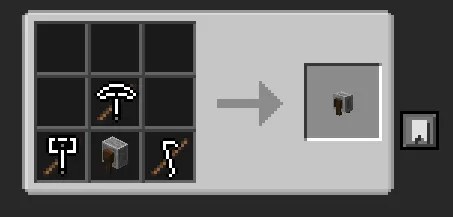
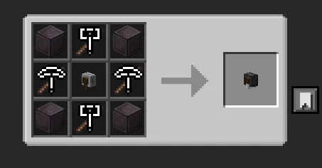
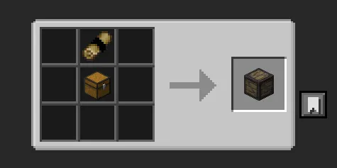
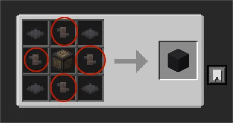

## 迷你砂轮

迷你砂轮为整合包新增魔改物品之一{.read-more}

- 鼠标持有时右键模块化物品将消耗物品耐久并将其打磨值充满
- 使用迷你下界合金砂轮时不消耗物品耐久
- 该打磨机制与磨刀石/超限磨刀石不同，为通过等效正常使用物品增加打磨值，因此可以积累工具稳固等级。

==同类型方块==：迷你砂轮、迷你下界合金砂轮

  
图1 迷你砂轮配方。图标代表对应工具种类，==每种工具等级要求>2=={.tip}

  
图2 迷你下界合金砂轮配方。==每种工具等级要求>6=={.tip}

## 卷轴箱

卷轴箱为整合包新增魔改方块之一{.read-more}

- 任意卷轴放入卷轴箱时，改造工具时将自动读取附近卷轴箱内卷轴并使其生效。
- 木制卷轴箱不会使其中的深奥的记录类卷轴生效。

==同类型方块==：木制卷轴箱、锻造卷轴箱。

  
图3 木制卷轴箱配方。==卷轴为任意卷轴=={.tip}

  
图4 锻造卷轴箱配方。画圈物品可为==润滑剂发射器=={.tip} / ==隔热板=={.tip} / ==燃烧室=={.tip} / ==平面稳定器=={.tip}
