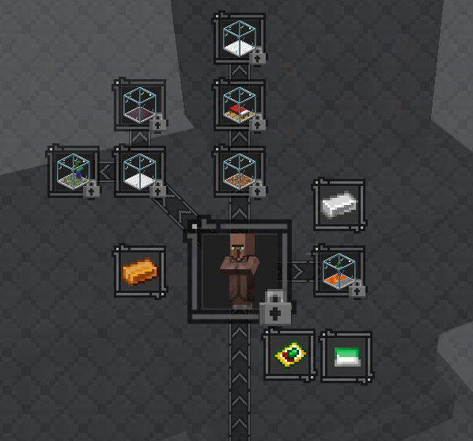
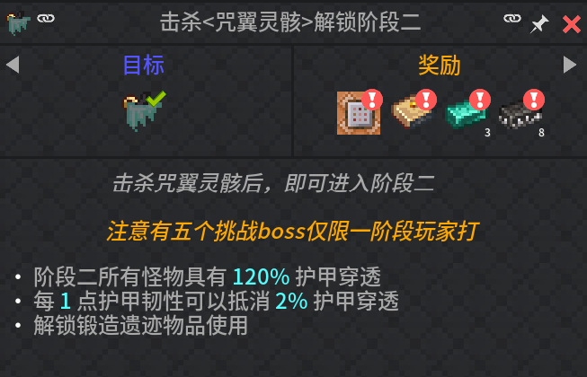

初步了解本包锻造机制和大体流程

本阶段：普通生物及敌怪×2，精英怪血量×5，boss血量×10{.read-more}

## 介绍

初始阶段，玩家可以趁此时期学习本包tetra原版和魔改锻造机制以及任务流程。

一阶段只包含主世界，同时添加了大量遗迹和资源点结构，包含玩家开局所需的大部分材料。添加了 ==简单村民== 模组和 ==jerotes的村庄== 模组以方便玩家通过快速村民交易以获取原版大部分资源。

::: note 注意
在一阶段时锻造遗迹内相关方块禁止交互，只允许使用锤类工具挖掘锻造墙及衍生方块获取金属碎片。
:::
当一阶段流程进行到一定进度后玩家通过任务可获得==精致存储==完整配套组件便于玩家存储探索过程中获得的大量物品，至此玩家可以对自己的工具护甲进行初步改造，合适之后就可以尝试挑战一阶段的小boss。挑战成功后可以使用其特殊掉落物强化锤等级、制作tetra饰品。

## 解锁项目

Tetra饰品

- 生命/绿宝石/十字章项链
- 手套
- 磁力/掠夺/炼金之戒
- 足力健
- 灾变之心（详情见tetra饰品页面）

卷轴：见[卷轴](../scrolls/卷轴1.md)页面

锻造模板和盔甲纹饰：见[锻造模板](../锻造模板.md)页面

可用工具等级：锤5级 切削4级 斧5级锻造锤方块在一阶段不可用

## BOSS

**注**：高亮仅限当前阶段挑战  
!!不信邪你可以去试试:yum:!!

::: table hl-cols="warning:4"

|小BOSS|大BOSS|关底BOSS|支线额外BOSS|
|:--------:|:--------:|:--------:|:--------:|
|蔓生巨像 南瓜伯爵 霜冻傀儡 魄攫圣骑 沙丘哨兵 旧日冠军骑士遗骸 荒古守卫者| 利维坦 南瓜领主 监守者 雪人 炼狱巨龙 沙虫|咒翼灵骸|砂铸巨兽 奇美拉枯骨 冰棘海 啸翼龙蜥 无名守卫者|

:::

## 进入二阶段

完成任务书中的==击杀 **<咒翼灵骸>** 解锁阶段二=={.important}任务并领取奖励

