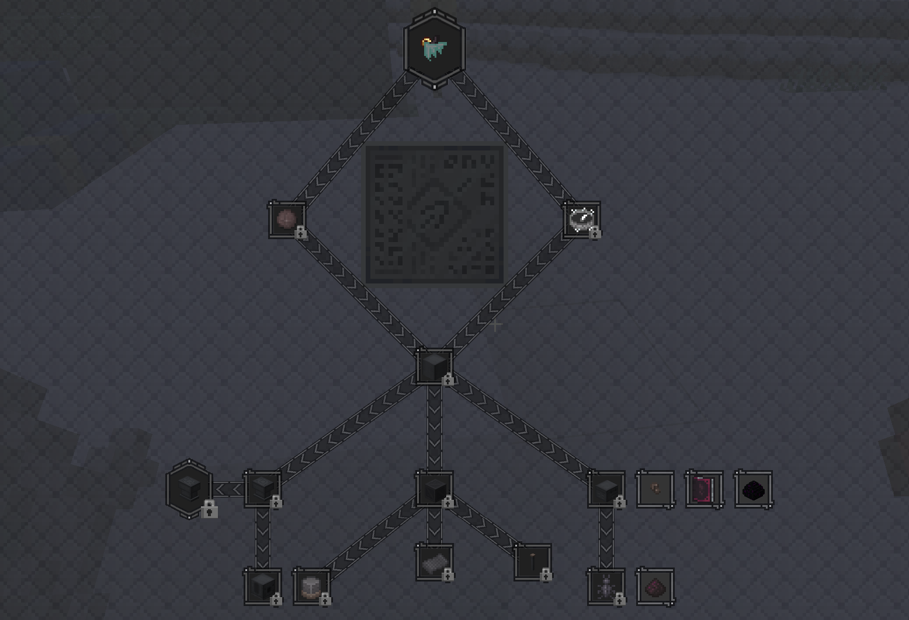
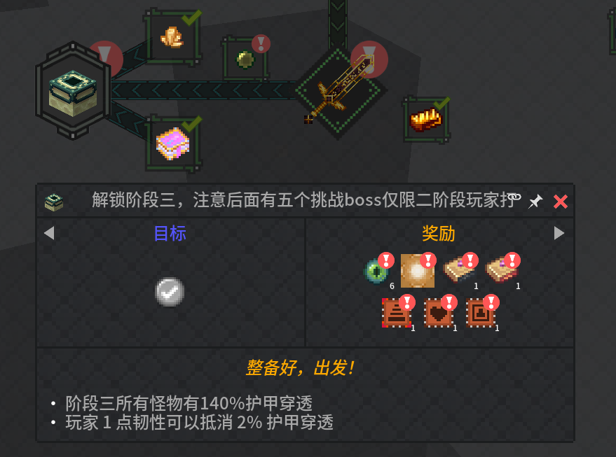

了解整合包流程机制后稳步推进并进一步探索获取更强的材料

本阶段：生物在一阶段血量膨胀的基础上==全体增加120%护甲穿透=={.note}，但玩家每一点护甲韧性可抵消2%护甲穿透 ==**护甲韧性在本包十分重要**== 。{.read-more}

## 介绍

与一阶段相比，二阶段开放了锻造遗迹的相关交互方块的使用权，该结构中有锻造锤方块、锻造台方块、古代原理图方块以及各种强化材料。

玩家可以使用带有`精准采集`附魔的锤采集锻造遗迹相关方块。本包经过魔改==移除=={.danger}了动力电池充能系统，取而代之的是锻造锤模块化改造系统，详情请移步[锻造锤改造](/docs/forge/box/1.锻造锤改造.md)页面。
::: note 遗迹锻造锤未经改造无法使用
:::

从二阶段开始，为推进任务进度玩家将在一个阶段同时探索多个维度，这也带来了大量新材料和大量新武器系统，是绝大部分流派开始崭露头角百家争鸣的阶段。二阶段不断增加的强度致使对流派特化发展的要求更高，不知道自己想选择哪个流派的玩家请移步流派简介页面，该页面为玩家提供了大致发展方向的选项。

## 解锁项目

可探索的维度

- 一阶段维度
- 下界
- 深暗之园
- 整合包魔改洞穴维度
- 帕斯特之梦：染梦世界 风之旅者 灯影之下（可能令人不适，请酌情探索）

Alex洞穴出现地点

- 糖果龋洞→染梦世界
- 毒化洞穴→下界
- 异寂空谷/磁场洞穴→整合包魔改洞穴维度

Tetra饰品

- 生物毒素瓶
- 皇冠
- 蒸汽引擎（详情见tetra饰品页面）

卷轴：见[卷轴](../scrolls/卷轴2.md)页面

模板和盔甲纹饰：见[锻造模板](../锻造模板.md)页面

可用工具等级：锤7级 切削5级 斧7级

## BOSS

**注**：高亮仅限当前阶段挑战

::: table hl-cols="warning:5"

|原版BOSS|小BOSS|大BOSS|关底BOSS|支线额外BOSS|
|:------:|:------:|:------:|:-------:|:-----------:|
|凋灵|冥界骑士 熔岩食者 骷髅蜥龙 凋灵恶煞 腐朽的王 撼地斯拉|先驱者 远古遗魂 下界合金巨兽 斯库拉 破风骑士 亚伦柯斯之触 遗忆守卫 遗弃者 磁控机兵|焰魔|狱岩魔像 铁铠冥魂 混沌君主 月光骑士 不朽者(支线关底)|

:::

## 进入三阶段

完成下界、帕斯特之梦、深暗之园和洞穴维度三条任务路线

帕斯特之梦路线由于灯影之下维度即便添加护眼材质仍可能令人感到不适，因此不强制完成

