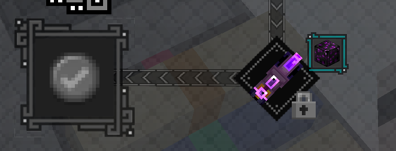
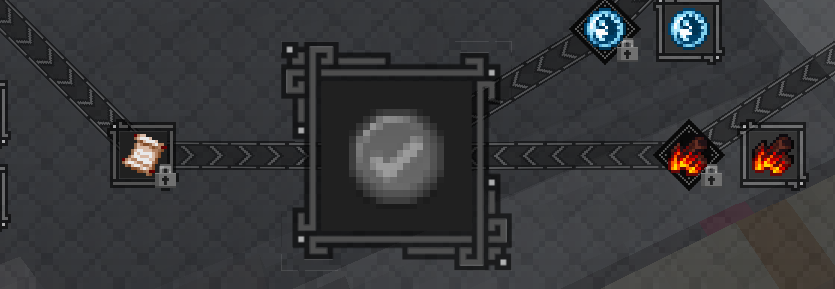

杀穿整合包让流派登峰造极

本阶段：生物在一二阶段血量膨胀的基础上全体再增加至==10倍血量==，==5倍护甲==，==1.5倍攻击力==，同时==增加140%护甲穿透=={.note}，护甲韧性抵消穿透的比率不变。{.read-more}

**现在末影龙每次死亡默认掉落1个龙蛋**

## 介绍

三阶段将会开放末地和二轮世界，探索unusual end模组提供的群系和二轮世界并强化锻造锤与锻造工具挑战三阶段的BOSS，获取最强材料！

三阶段任务中会出现一个特殊事件——==灾厄旗帜袭击==，与末地任务线互相牵制，完成这一事件才能挑战末地任务线最终BOSS——末地守卫。

## 解锁项目

可探索维度

- 一二阶段所有维度
- 末地
- 二轮世界

Alex洞穴出现地点

- 渊海陷窟/原始洞穴→二轮世界

Tetra饰品

- 护心镜
- 荣耀之证
卷轴：见[卷轴](../scrolls/卷轴3.md)页面

模板和盔甲纹饰：见[锻造模板](../锻造模板.md)页面

可用工具等级：锤9级 切削7级 斧9级

## 三阶段会出现的BOSS

|原版BOSS|小BOSS|大BOSS|关底BOSS|支线额外BOSS|
|:----:|:----:|:----:|:----:|:----:|
|末影龙|末地石傀儡 潜影拟态者 昼从者/夜伏者 末地遣使 繁兴使者 沉降领主|紫沙鬼婆 蚀龙兽 蛇龙执战者 明路巨兽 碎船兽 暝煌龙 镇山大王|末影守卫|无|

## 进入四阶段

完成末地、二轮世界两条任务路线

## 四阶段（结束了？）

普遍认为三阶段结束后整合包已经通关，但那些追求更多更刺激的战斗的人呢？

四阶段为追求极限的玩家准备了一个特殊的竞技场维度，玩家可以在其中开启无尽挑战

**无尽挑战机制**

1. 四阶段的任务奖励会给玩家特殊道具`绯红钥匙`，手持潜行使用后将传送到四阶段维度，加载片刻后竞技场浮岛将会出现，右击中心的召唤祭坛可以开启无尽挑战。
2. 关卡难度会越来越高且波次无上限但打通50波可视为通关，奖励为三个通用饰品栏位。
3. 每五波为精英怪波次，通关获得钻石奖牌，手持右键可跳过三波次；每十波为BOSS波次，通关可获得下界合金奖牌，手持右键可跳过五波次。

::: tip 来自笔者的一句忠告
小心大舌头舐脑魔，小心不要压血压太狠,小心蚀龙兽对你设备的卡顿攻击。
:::

---

至此本整合包的所有流程算是结束了，但一路走来也没有人能玩遍所有流派。所以在此我建议多周目游玩以获得更多游戏体验，或者加入官方讨论群和频道，学习他人的锻造心得，提升自己的眼界。
